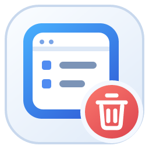
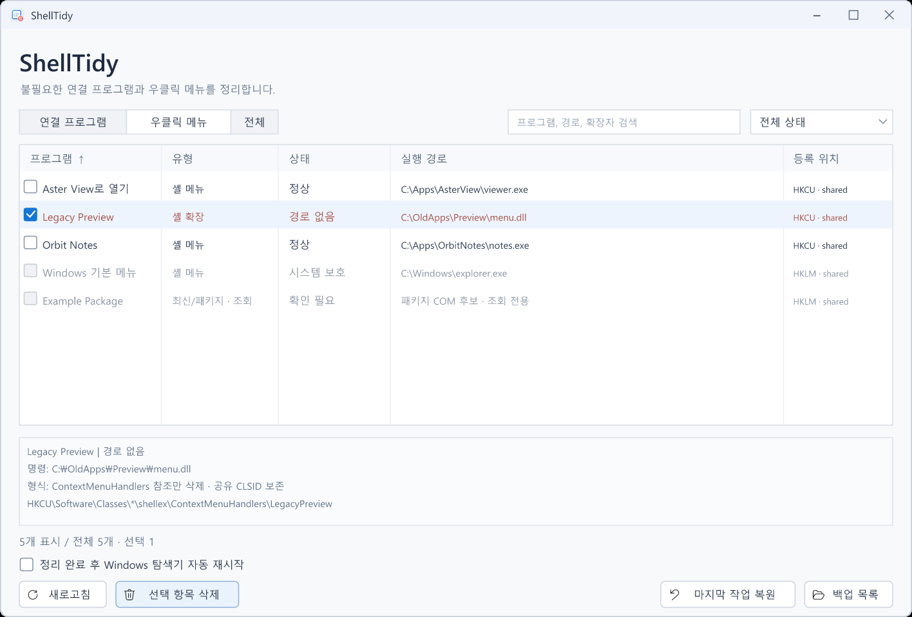

<p align="center"></p>
<h1 align="center">ShellTidy</h1>
<p align="center"><b>연결 프로그램과 우클릭 메뉴에 남은 오래된 등록을 정리하세요.</b></p>

<p align="center">
  
  
  <a href="LICENSE"></a>
  
</p>

<p align="center">
  <a href="https://github.com/deuxdoom/ShellTidy/releases/latest/download/ShellTidy.exe"></a>
  <a href="https://github.com/deuxdoom/ShellTidy/releases/tag/v0.0.1"></a>
</p>

<p align="center">
  <a href="#features">주요 기능</a> &nbsp;·&nbsp;
  <a href="#usage">사용 방법</a> &nbsp;·&nbsp;
  <a href="#build">직접 빌드</a> &nbsp;·&nbsp;
  <a href="#backup">백업과 복원</a> &nbsp;·&nbsp;
  <a href="#limits">지원 범위</a> &nbsp;·&nbsp;
  <a href="CHANGELOG.md">변경 내역</a> &nbsp;·&nbsp;
  <a href="index.html">소개 페이지 소스</a>
</p>

## 소개

프로그램을 옮기거나 삭제한 뒤에도 Windows의 **연결 프로그램(Open With)** 과
**우클릭 메뉴**에 예전 항목이 남을 수 있습니다. ShellTidy는 실제 레지스트리 등록을
찾아 경로와 출처를 보여 주고, 사용자가 선택한 등록을 백업한 뒤 삭제하는 작은 Windows 앱입니다.

예를 들어 `Picvium.Image.jpg`와 `Picvium.Installed.Image.jpg`가 서로 다른 실행 경로를
가리킨다면 각각 확인할 수 있습니다. 이름만 같다고 합치지 않으며, 같은 명령을 가리키는
여러 확장자 참조는 함께 선택할 수 있도록 묶습니다.

**단일 EXE**로 실행하며 설치 과정이나 .NET·Python·VC++ 재배포 패키지가 필요하지 않습니다.
실행 파일에는 정적 MSVC 런타임과 아이콘이 들어 있습니다. Windows 기본 시스템 DLL은 사용합니다.

## 화면 미리보기

현재 UI 배치를 바탕으로 **가상의 앱 이름·경로·등록으로 재구성한 예시 화면**입니다.



<a id="features"></a>

## 주요 기능

- **모든 확장자 검색:** HKCU FileExts, HKCU/HKLM Classes의 OpenWithList·OpenWithProgids,
  Applications 및 RegisteredApplications의 파일 연결 참조를 조사합니다.
- **일반 메뉴 검색:** 파일·폴더·폴더 배경·드라이브 및 ProgID의 정적 shell verb와
  COM ContextMenuHandlers를 구분합니다.
- **경로별 구분:** 정상, 실행 파일 없음, 중복 의심, 확인 필요, 시스템 보호 상태를 표시합니다.
  상태 표시는 삭제 권고가 아니며, 경로를 해석하지 못하면 확인 필요로 남깁니다.
- **검색과 정렬:** 이름·경로·확장자·ProgID 검색, 유형/상태 필터,
  각 열 클릭으로 가나다·ABC·자연수 기준 오름차순/내림차순 정렬을 지원합니다.
- **실제 삭제:** 선택한 참조 값이나 개별 메뉴/앱 키를 삭제하고 OpenWithList의 MRUList를 정리합니다.
  공유 ProgID와 CLSID 전체는 제거하지 않습니다.
- **자동 백업과 복원:** 값 이름·유형·바이트를 보관하며, 현재 값과 충돌하면 덮어쓰지 않습니다.
- **선택적 탐색기 재시작:** 변경 성공 후 연결 변경을 통지합니다. 자동 재시작 옵션은
  **기본 체크 해제**이며, 체크한 작업에서만 재시작합니다.
- **가벼운 네이티브 UI:** 비동기 검색과 안전한 단계에서의 취소, 한글 경로,
  Windows UI 언어에 따른 한국어/영어 선택, DPI 배율 대응을 구현했습니다.
- **작은 창과 짧은 팝업:** 창은 모니터 작업 영역 중앙에 열립니다. 확인/결과 팝업은
  스크롤 없는 요약과 전체 내용 복사 버튼을 제공합니다. 같은 사용자·세션에서 다시 실행하면
  기존 창을 활성화합니다.

<a id="usage"></a>

## 사용 방법

1. [최신 릴리스의 ShellTidy.exe](https://github.com/deuxdoom/ShellTidy/releases/latest/download/ShellTidy.exe)를 내려받아 실행합니다. 직접 빌드한 파일은 `dist/ShellTidy.exe`에 있습니다.
2. 연결 프로그램 또는 우클릭 메뉴 탭에서 항목을 검색합니다.
3. 실행 경로와 상세 정보의 확장자·ProgID·실제 키/값을 확인한 뒤 삭제할 항목을 체크합니다.
4. **선택 항목 삭제**를 누르고, 영향받는 레지스트리 위치를 확인합니다.
5. 필요하면 **정리 완료 후 Windows 탐색기 자동 재시작**을 체크하고 진행합니다.
6. 잘못 선택했다면 **마지막 작업 복원** 또는 **백업 목록**에서 복원합니다.

HKCU 정리에는 관리자 권한을 요구하지 않습니다. 쓰기 권한이 부족한 등록을 처리할 때만
UAC 작업자를 요청합니다. 다른 관리자 계정의 자격 증명을 사용한 작업은 사용자 하이브 혼동을
막기 위해 지원하지 않습니다.

탐색기 재시작을 선택하면 파일 복사·이동 작업과 열린 탐색기 창이 중단될 수 있습니다.
확인 화면에도 이 내용을 표시합니다. 삭제가 전혀 성공하지 않으면 재시작하지 않습니다.

<a id="backup"></a>

## 백업과 복원

기본 백업 위치는 `%LOCALAPPDATA%\ShellTidy\Backups`입니다.
삭제 전 `.stb` 파일을 디스크에 기록·확정하고, 각 변경의 진행 상태를 갱신합니다.
파일은 손상 검사용 체크섬을 포함한 ShellTidy 전용 바이너리 형식이며 `.reg` 파일이 아닙니다.

복원은 해당 작업이 백업한 등록만 대상으로 합니다. 이후 추가된 무관한 값을 보존하고,
동일 값이 다른 내용으로 존재하면 충돌로 표시합니다. 앱 파일, 설치 폴더, 문서, Obsidian Vault는
삭제하거나 복원하지 않습니다.

백업 위치를 바꾸려면 실행 전 `SHELLTIDY_BACKUP_DIR`에 절대 경로를 지정할 수 있습니다.
개발/자동 테스트는 F 드라이브의 격리 백업 위치를 사용합니다.

<a id="build"></a>

## 직접 빌드

필요한 개발 도구는 **Visual Studio C++ x64 빌드 도구와 Windows SDK, PowerShell**입니다.
Visual Studio 2026 Insiders / MSVC 14.52 / Windows SDK 10.0.26100.0으로 빌드했습니다.

```powershell
git clone https://github.com/deuxdoom/ShellTidy.git
cd ShellTidy
msbuild ShellTidy.vcxproj /p:Configuration=Release /p:Platform=x64
```

Visual Studio 개발자 PowerShell에서 위 명령을 실행하거나 `ShellTidy.vcxproj`를 열어
Release / x64로 빌드하세요. 결과는 **`dist/ShellTidy.exe`**, 중간 파일은 `build/`에 생성됩니다.
`/std:c++20 /O2 /MT`를 사용하며 별도 라이브러리 설치가 필요하지 않습니다.
개발 중 C 드라이브에 임시 파일을 만들지 않으려면 빌드 전에 `$env:TEMP`와 `$env:TMP`를
F 드라이브의 작업 디렉터리로 지정하세요. 프로젝트 전용 도구는 `tools/`에 모았습니다.
로컬 도구 준비·빌드·검증·이미지 재생성 방법은 [tools/README.md](tools/README.md)를 참고하세요.
개발 PC에서는 Python·Node·Git·MSVC·SDK도 `tools/runtime`, `tools/vendor`, `tools/toolchain`에
준비한 복사본으로 실행합니다.

격리 레지스트리 테스트까지 실행하려면:

```powershell
New-Item -ItemType Directory -Force build\test-backups | Out-Null
$env:SHELLTIDY_BACKUP_DIR = "$PWD\build\test-backups"
$report = "$PWD\build\test-results.txt"
$test = Start-Process .\dist\ShellTidy.exe -ArgumentList @('--self-test',('"' + $report + '"')) -PassThru -Wait
Get-Content build\test-results.txt
$test.ExitCode
```

자동 테스트는 `HKCU\Software\ShellTidy\Tests\Run-*` 아래의 테스트 등록만 변경합니다.
사용자 앱의 실제 연결 등록이나 실제 Explorer 프로세스를 삭제·종료하지 않습니다.
검증 범위와 수동 확인 항목은 [TESTING.md](TESTING.md)에 기록합니다.

언어를 직접 확인할 때는 `--korean`, `--english`를 사용할 수 있습니다.
아이콘·Social Preview·가상 UI 이미지 원본은 `assets/`, 재생성 스크립트는 `tools/`에 있습니다.
이미 생성된 ICO가 포함되어 있으므로 일반 EXE 빌드에 Python은 필요하지 않습니다.

<a id="limits"></a>

## 지원 범위와 제한

- Windows 10/11 x64를 대상으로 합니다. 현재 실기 검증은 Windows 11 개발 PC에서 진행했습니다.
- 현재 기본 앱 및 확인된 Windows 구성요소를 보호합니다. **UserChoice는 직접 수정하지 않습니다.**
- Windows 11 ExplorerCommand·DelegateExecute·캐스케이드 메뉴와 패키지 COM 후보는
  조회 전용입니다. 패키지 COM 후보가 모두 컨텍스트 메뉴인 것은 아닙니다.
- 동적으로만 등록되는 패키지 메뉴 전체를 열거하거나 제거하는 기능은 없습니다.
- 공유 ProgID를 보존하므로 선택하지 않은 다른 출처가 남아 있거나 앱이 재등록하면
  메뉴 항목이 다시 나타날 수 있습니다.
- 실제 Explorer 종료/재실행, 승격 토큰 실행 및 대화형 UAC 취소는 별도의 수동 검증 대상입니다.
- 100~200% DPI 대응 코드는 구현했지만 전체 배율별 화면 검수는 아직 완료하지 않았습니다.

## 소스와 라이선스

전체 앱 소스는 `src/`, 리소스는 `resources/`에 공개합니다.
ShellTidy는 [MIT License](LICENSE)입니다. 내부 버튼의 Fluent UI 아이콘에도 MIT 라이선스를
적용하며 원문 고지는 [THIRD_PARTY_NOTICES.md](THIRD_PARTY_NOTICES.md)와 EXE 안에 포함합니다.
창의 시스템 메뉴에서 **ShellTidy 정보**를 열어 버전과 고지를 확인할 수 있습니다.

Copyright (c) 2026 SAKURA.
